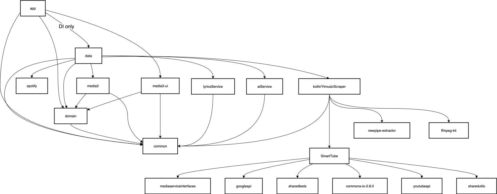

  

# D-Spot

**Your music. Your library. Your listening space.**

A YouTube Music and YouTube client for Android and Desktop, built with Kotlin Multiplatform and Compose.

[Website](https://dspot-web.vercel.app/) · [Releases](https://github.com/nrgskripe1-eng/D-Spot/releases) · [Report an issue](https://github.com/nrgskripe1-eng/D-Spot/issues)

---

## About D-Spot

D-Spot brings music discovery, playback, library management, and listening tools together in one application. It works with content from YouTube Music and YouTube, with a feature set designed for both mobile and desktop listening.

The project is developed with **Kotlin Multiplatform** and **Jetpack Compose**, sharing application foundations across supported platforms while adapting the experience to each device.

D-Spot is not affiliated with or endorsed by Google, YouTube, or Spotify.

## Get D-Spot

Choose the build that matches your device.

For vivo devices that need Origin Island and the music widget, use the `D-Spot-full-vivo-*.apk` build from [GitHub Releases](https://github.com/nrgskripe1-eng/D-Spot/releases). This build installs as a separate app and cannot be installed alongside Spotify.

### Desktop

D-Spot is also available for desktop with direct in-app sign-in.

- **Windows:** Download D-Spot-Windows-installer.zip, extract it, then run install.bat.
- **macOS:** Download the .dmg build. macOS 15 or newer is required.
- **Linux:** Download the .AppImage build.

You can directly sign in to your YouTube and music accounts straight from the app's login page without needing external QR codes.

On Windows and Linux ARM64 devices, use the x64 build.

---

## What you can do with D-Spot

Features are grouped by what they help you do, rather than by platform screen.

### Listen and play

- Play music from YouTube Music or YouTube with background playback.
- Choose between Classic, Material 3 Expressive, and Apple Music-inspired Now Playing layouts.
- Stream up to 256 kbps Opus or AAC when using a YouTube Music Premium account.
- Play YouTube Music live stations.
- Play videos at up to 1080p with subtitles.
- Select the audio language when a video provides multiple audio tracks.
- Use crossfade with DJ-style transitions.
- Cache content for supported offline playback.
- Use the sleep timer.
- Select the playback output, including speakers, headphones, and Cast devices, without moving other apps' audio.

### Discover and organize

- Browse Home, Charts, Podcasts, Moods, and Genres.
- Search across YouTube.
- Explore music recommendations and listening suggestions.
- Import playlists converted from Spotify and other services.
- Customize playlists and sync them with YouTube Music.
- Follow artists and receive notifications about them.
- Use D-Spot Chart for chart discovery: [chart.dspot.app](https://dspot-web.vercel.app/chart).

### Lyrics and artwork

- View synchronized lyrics from D-Spot Lyrics, LRCLIB, Spotify (sign-in required), and YouTube transcripts.
- Follow word-by-word lyrics with supported sources.
- Use romanization for 12 languages.
- Adjust lyric timing and view lyrics in fullscreen landscape mode.
- Share lyrics as an image.
- Translate lyrics with AI (beta).
- View Spotify Canvas and animated album artwork.

### Personal listening tools

- Review D-Spot Wrapped, yearly listening recaps, and monthly recap playlists.
- Explore on-device listening analytics, including charts, listening history, listening time, and shareable listening receipts.
- Add home-screen widgets for the turntable, playlists, and listening insights.
- Personalize app data and use multiple YouTube accounts.
- Scrobble listening activity to Last.fm (Full version).

### Audio and playback customization

- Adjust sound with a ten-band equalizer and presets.
- Use AutoEq headphone profiles.
- Configure delay and reverb effects.
- Use the device's system equalizer on Android.
- Customize the app theme, including light, dark, and color-based options.

### Community and connected features

- Use SponsorBlock and Return YouTube Dislike.
- Connect Discord Rich Presence.
- Join Listen Together rooms and synchronize playback with friends; compatible with Metrolist.
- Direct in-app sign-in supported across mobile and desktop.

Some features require account sign-in, a supported service, a compatible device, or an API key. AI lyric translation and AI-powered music features may require an OpenAI or Gemini API key.

---

---

## How D-Spot works

D-Spot retrieves catalog information and media stream data from services it supports. The application uses a combination of project-specific components and community projects to provide playback, lyrics, recommendations, and related features.

### Data sources and integrations

- **YouTube Music:** Catalog and listening data through its internal, undocumented interfaces.
- **YouTube:** Video and stream-related data.
- **Spotify Web API:** Used for supported Canvas and lyrics features.
- **SponsorBlock:** Helps skip sponsored segments in supported YouTube videos.
- **Return YouTube Dislike:** Supplies dislike information.
- **D-Spot Lyrics:** Main lyrics source.
- **LRCLIB:** Alternative lyrics source.

### Architecture

The application follows a Clean Architecture approach, with MVVM used in the UI and app module.

 
  

---

## Privacy and data

D-Spot's FOSS version does not include trackers or a third-party server for collecting user data.

If a signed-in YouTube user enables **Send back to Google**, D-Spot uses the YouTube Music Tracking API to send listening history and video listening records to Google. This supports recommendations and helps support artists and YouTube creators.

The Full version collects crash data through Sentry to help improve the application. Users who do not want crash data collected can use the FOSS version.

For the implementation details of the YouTube Music tracking integration, see the [Ytmusic.kt source](https://github.com/Mika/core/blob/master/service/kotlinYtmusicScraper/src/commonMain/kotlin/com/mika/kotlinytmusicscraper/Ytmusic.kt).

## Project status and support

D-Spot is in beta. Bugs, crashes, and playback issues may occur, including issues caused by changes to YouTube Music or YouTube services.

If you encounter a problem:

1. Check whether you are using the latest available build.
2. Search the [existing issues](https://github.com/nrgskripe1-eng/D-Spot/issues).
3. If the issue has not been reported, [open a new issue](https://github.com/nrgskripe1-eng/D-Spot/issues/new) with the relevant details.

## Help improve D-Spot

Contributions, translations, and bug reports are welcome.

- Read the [contribution guide](CONTRIBUTING.md) before opening a pull request.
- Help translate D-Spot through [Crowdin](https://crowdin.com/project/dspot).
- Review the [Code of Conduct](https://github.com/nrgskripe1-eng/D-Spot/blob/main/CODE_OF_CONDUCT.md).

Please follow the repository's contribution process. Pull requests should be connected to an accepted issue, and translations should be submitted through Crowdin rather than by editing translation files directly.

## Credits and project origins

D-Spot's development builds on ideas and work from the wider community. Special thanks to:

- [InnerTune](https://github.com/z-huang/InnerTune) inspiration for retrieving YouTube Music data.
- [SmartTube](https://github.com/yuliskov/SmartTube) research and techniques related to extracting YouTube stream URLs.
- [SponsorBlock](https://sponsor.ajay.app/) sponsored-segment data.
- [Return YouTube Dislike](https://returnyoutubedislike.com/) dislike information.
- [LRCLIB](https://lrclib.net/) alternative lyrics data.
- The translators and contributors who help improve D-Spot.

D-Spot's current name, presentation, and product direction are maintained in this repository. This section acknowledges project history and upstream work; it does not replace the licenses or notices included in the source code.

## Legal information

### Intended use

D-Spot is a client application intended for personal and educational use. It is provided without advertisements, paid features, subscriptions, or in-app fees.

### Content and hosting

D-Spot acts as a client interface for content available through YouTube and YouTube Music. It does not operate its own service for hosting or distributing audio or video media. Media remains the property of its respective rights holders.

### Respect for creators

Users are encouraged to support artists and creators through official subscriptions, live events, merchandise, and other authorized channels.

### Disclaimer

The software is provided "AS IS", without warranty of any kind, express or implied. The developers do not encourage or condone copyright infringement. Users are responsible for ensuring that their use complies with applicable laws and third-party terms.

D-Spot does not host the media it displays and cannot process takedown requests for content hosted by Google or YouTube. For general inquiries, contact
---

## Community and support

[Website](https://dspot-web.vercel.app/) · [GitHub Discussions](https://github.com/nrgskripe1-eng/D-Spot/discussions) · [Issues](https://github.com/nrgskripe1-eng/D-Spot/issues)

---

D-Spot is an independent community project and is not affiliated with Google, YouTube, or Spotify. Product names and trademarks belong to their respective owners.
